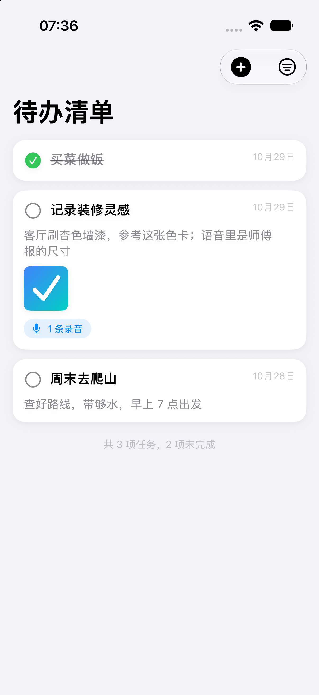

<div align="center">

# TaskFlow · 待办清单

**每个任务都是一张卡片 —— 标题、文字、图片、语音，装进同一张卡里。**

一个用 SwiftUI 打造的 iOS 任务卡片 App，零第三方依赖。



</div>

---

## ✨ 功能特性

- 🗂 **卡片式任务** —— 圆角卡片展示标题、日期与内容预览，一眼一块
- 📝 **富内容任务** —— 标题（必填）+ 文字描述 + 相册图片（多张）+ 语音备注（多条）
- 🎙 **录音与播放** —— 任务内直接录制语音，卡片内直接播放，带进度条
- ✅ **完成管理** —— 一键切换完成状态、筛选（全部 / 未完成 / 已完成）、批量清除已完成
- 💾 **本地持久化** —— JSON + 附件文件存储，旧版本数据自动无损迁移
- 🌗 **自动适配** 深色模式，iPhone / iPad 通用，最低支持 iOS 18

## 🛠 技术栈

| 模块 | 方案 |
|---|---|
| UI | Swift 5 · SwiftUI（NavigationStack / Form / LazyVStack） |
| 图片选取 | PhotosPicker（PhotosUI，无需相册权限） |
| 录音 / 播放 | AVAudioRecorder · AVAudioPlayer（AVFoundation） |
| 持久化 | JSON 文件 + Documents 附件目录 |
| 依赖 | **无**，纯系统框架 |

## 📁 工程结构

```
TaskFlow/
├── TaskFlow.xcodeproj
└── TaskFlow/
    ├── TaskFlowApp.swift    # App 入口
    ├── ContentView.swift    # 卡片列表、筛选、统计
    ├── TaskEditorView.swift # 新建/编辑表单（标题必填、图片、录音）
    ├── AudioViews.swift     # 录音器 + 播放组件
    ├── TodoStore.swift      # 数据模型 + 文件持久化 + 附件管理
    └── Assets.xcassets      # 图标与主题色
```

## 🚀 如何运行

1. 克隆仓库：`git clone https://github.com/<你的用户名>/TaskFlow.git`
2. 双击打开 `TaskFlow.xcodeproj`
3. 选择 iPhone 模拟器，按 `Cmd + R` 运行

> **真机运行**：在 Xcode → Signing & Capabilities 里选择你自己的 Apple ID（免费账号即可），首次运行需在手机上信任开发者证书。

> **注意**：首次使用录音会请求麦克风权限；图片从相册选取，无需相册访问权限。

## 📸 界面预览

| 卡片列表 |
|---|
|  |

## 🗓 开发计划

- [ ] 任务搜索
- [ ] 到期提醒（本地通知）
- [ ] 相机拍摄直接添加图片
- [ ] 卡片颜色 / 标签分类
- [ ] iCloud 同步

## 📄 许可证

[MIT](LICENSE) © 2026 Andy
